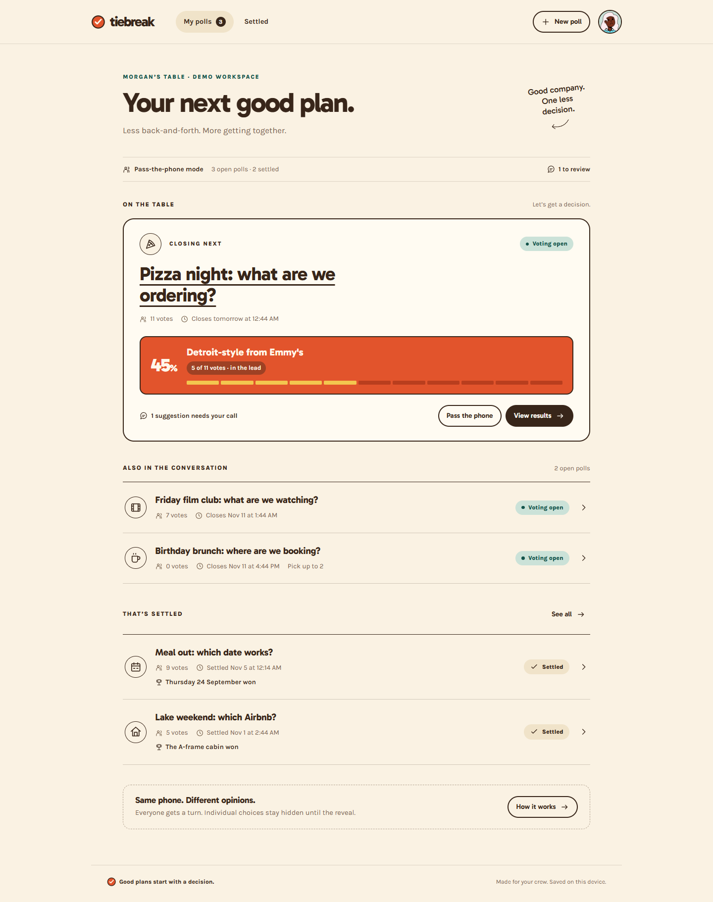

# Tiebreak

Good plans start with a decision. A group polling app built with HTML, CSS, and vanilla JavaScript for the [Frontend Mentor product challenge](https://www.frontendmentor.io/challenges/poll-creator-app).

**Local guest demo:** [http://localhost:5173/#/guest](http://localhost:5173/#/guest), after `npm run dev`.

**Delivery:** a local, frontend-only application. The production build is in `dist/`, and `npm run release:prepare` verifies it and produces `artifacts/tiebreak.zip`. No external server or hosting is needed for development, testing, or packaging.

**Netlify:** the repository includes `netlify.toml` with build command **`npm run build`** and publish directory **`dist`**. For a manual deploy, upload the built **`artifacts/tiebreak.zip`**, not the source repository archive. See the [Netlify setup guide](docs/NETLIFY.md).



## The product

This solution takes the specification’s **frontend-only, pass-the-phone path**. A host creates a poll, passes their device around the group, reviews suggestions, and reveals the decision. Polls and votes persist in this browser’s local storage. There are no accounts, remote ballots, databases, or external API requests.

The interface reflects that choice: the share step says “pass the phone”; local links are explicitly labeled as local; portable artifacts are the final text result and PNG share card. A poll URL opened on another device shows an explanatory missing-poll screen.

### Included

- Landing page, empty workspace, and editable guest workspace seeded with all five supplied polls and 32 votes.
- Dashboard featuring the earliest-closing poll, open/settled sections, and pending-suggestion counts.
- Creation with 2–10 distinct options, a local-time deadline, single choice or up-to-N picks, and optional suggestions.
- Six locally generated DiceBear Micah faces and four background colors.
- Initially unselected ballot, selection-aware submit button, and explicit final-vote confirmation.
- Named confirmation, live counts on this device, returning-voter state, and “Pass to next voter”.
- Named suggestions, private pending items, approval with zero votes, and decline with persistent Undo.
- Automatic closing, early closing, attribution at the reveal, and confirmed reopening with a new deadline.
- Honest tied, zero-vote, and one-vote states; counts beside percentages; relative trailing bars.
- Distinct Copy result, Save image, and Copy local link actions, with clipboard fallback.
- Confirmed deletion and workspace reset, editable host name, and storage-error feedback.
- Responsive layouts, native forms and dialogs, deliberate focus management, and status announcements.

No animation or poll templates are included, as requested.

## Run locally

Requires Node.js 20.19+ and npm; `.nvmrc` selects Node.js 22 for Netlify and nvm. No environment variables or API keys are needed.

```sh
npm ci
npm run dev
```

Open **http://localhost:5173**. The development server builds and watches source files. Return to saved polls using the same browser and origin.

```sh
npm run build      # Production files in dist/
npm run package    # Build and create artifacts/tiebreak.zip for Netlify upload
npm run preview    # Serve that build on localhost:5173
npm test           # Product-rule tests with Node's built-in runner
npm run check      # JavaScript syntax checks
npm run test:e2e   # Browser journeys and axe accessibility checks
npm run verify     # Syntax, unit tests, and production browser tests
npm run release:prepare # Verify, build, and package locally
```

Browser tests use installed Google Chrome in headless mode. Set `PLAYWRIGHT_CHANNEL` to use another installed channel, such as `msedge`. `PORT` changes the development/preview port; `TIEBREAK_TEST_PORT` changes the isolated browser-test port (default 5174). All servers bind to **127.0.0.1** and serve only files from this repository. Tests run against the production build.

## Design decisions

### The voter's story

The ballot begins with a name and a preset face. The selected preset, rather than the typed name, determines the avatar; the preview and final vote use the same seed and tint. No ballot choice is preselected.

Confirmation repeats every chosen option and explains that the vote is final. After voting, the person sees “You’re in, Alex” and their own choice, followed by the current race. This makes the vote feel counted. Other people's choices stay hidden until closing, while aggregate counts are visible.

The turn token persists across refreshes, so returning shows the already-voted state. “Pass to next voter” deliberately creates a fresh token and clears the identity and selections. A late visitor gets the actual result rather than a disabled form.

### The reveal

The live screen uses tangerine for the leader, teal for system actions, and one tick per person for small groups. Closing gives the result more space and reveals the backers of every option. The reveal relies on type, color, and people rather than movement.

Tied leaders never get an arbitrary winner. A butter-colored panel states the tie in words; each option keeps its score and backers. With no votes there is no winner. With one vote the live copy says it is too early to call.

**Copy result** contains the question, winner or tied options, counts, percentage where appropriate, total voters, a multi-choice clarification if needed, and “Made with Tiebreak”. It contains no unusable remote voting link. **Copy local link** copies the ballot URL and announces its browser-only scope.

**Save image** is the chosen differentiator. Canvas produces a PNG with the question, outcome, exact counts, and backers. Its height grows with long titles and ties. Bundled avatars and fonts avoid cross-origin dependencies.

### First run

An empty dashboard asks “What are we deciding?” and points directly to a short form. The alternative is the seeded demo, not fake content inside a new personal workspace. After creation, the handoff screen opens the ballot. A zero-vote poll offers the same next action instead of inventing a leader.

The demo is a local copy: visitors can try moderation, voting, closing, and reopening without changing the supplied JSON. Dates shift relative to first seeding, preserving offsets. Stored polls then follow real time; deadlines do not reset on refresh.

### Product rules

| Decision | Behavior |
| --- | --- |
| Final votes | No editing or removal of individual votes. Identical token/selection retries are idempotent; changes are rejected. |
| Reopening | Confirmation and a new future deadline are required. Existing votes and tokens remain. |
| Deadlines | Stored in UTC; entered/displayed in the device's timezone. Checked on load, mutations, and while open. An expired poll settles at its exact deadline. |
| Suggestions | Pending → approved/declined. Undo explicitly restores a declined item to pending before approval. |
| Ballot limit | Maximum ten approved options. Pending suggestions cannot bypass that limit. |
| Multi-choice | Each person counts once per chosen option. Percentages divide by unique voters and may sum above 100%. |
| Above 20 voters | Exact counts replace individual ticks; trailing bars remain relative to the leader. |
| Decline Undo | Notification stays until dismissed, acted on, or replaced. Undo works while the poll is open. |
| Retention | No automatic deletion. Poll deletion and workspace reset require confirmation. |

## Implementation

| Part | Choice |
| --- | --- |
| UI | Semantic HTML, plain JavaScript modules, event delegation |
| Styling | CSS, supplied semantic tokens, single-column working screens |
| Type | Self-hosted Gabarito and Karla variable fonts |
| Storage | Versioned localStorage; counts derived from individual votes |
| Product rules | Pure functions in `src/domain.js` |
| Avatars | Bundled `@dicebear/core` and `@dicebear/micah`; data-URI SVGs |
| Build | esbuild; no application framework or runtime server |
| Browser checks | Playwright with axe-core |
| Hosting | Static build ready for deployment; hash routes work on static hosting |

Modules separate rules, workspace validation, storage, views, interactions, avatar helpers, and share-card rendering. User text is escaped before HTML insertion. Saved nested records and ballot integrity are checked before rendering. Damaged data stays untouched until an explicit reset.

Failed writes keep the previous workspace intact and leave the ballot available to retry. Deadlines still close the visible ballot if their updated state cannot be saved; persistence is retried when storage is available. Browser-tab updates preserve the current field, selection, and draft. Race announcements are throttled to one meaningful summary per four seconds. There is no analytics or remote avatar service; the loaded app can complete a round offline.

## Validation

Automated tests cover vote integrity, deadlines, multi-choice limits, moderation and Undo, zero-count approval, open-result attribution, reopening, and sample seeding. Browser journeys cover creation, the physical voting loop, tied reveals, PNG download, refresh persistence, keyboard behavior, and responsive reflow, with axe checks on primary screens.

Screenshots are in `docs/screenshots/`. See [QA notes](docs/QA.md) for recorded results and limits. Automated accessibility checks do not replace a real screen-reader test.

The [acceptance checklist](docs/REQUIREMENTS.md) maps the brief to the delivered frontend behavior and its verification.

## Local handoff and submission

`npm run release:prepare` runs verification, builds the static files, and creates `artifacts/tiebreak.zip` with a SHA-256 checksum alongside it. The archive contains the contents of `dist/`, including local fonts, avatars in the JavaScript bundle, and license notices. It contains no credentials, browser workspace data, or server code. The archive is generated entirely in the repository; nothing is uploaded.

Netlify configuration and a static upload package are provided; actual publication is left to the project owner. For a Git-based deploy, commit and push the configuration changes so Netlify can read them. For a manual deploy, `npm run package` builds the web files without requiring browser tests; upload its ZIP or the `dist/` folder. Hash routes need no application server. For a Frontend Mentor submission, the guest URL should end in `/#/guest`, alongside [this repository](https://github.com/pettik/FrontendMentor--poll-creator-app). State that this is the frontend-only path.

Existing `.openai/hosting.json` metadata is retained from earlier setup, but no local script uses it or contacts Sites. Source changes are not automatically committed or pushed. Each origin has separate browser storage; saved polls do not migrate between origins.

## Deliberate limits

This is for a group sharing one trusted device. The host is whoever controls the phone. There is no server authentication or anti-tampering. Someone can deliberately start another turn or edit local data. Remote voting and synchronization between devices require the full-stack path.

Manage a workspace in one tab at a time. Other tabs receive storage updates, but localStorage is not a transactional multi-client database. Clearing site data, changing browsers, or leaving private browsing removes access to local records. Result text and exported PNGs are portable.

There is no automatic 30-day retirement, dark mode, sudden-death round, or template system.

## Collaboration and credits

Built collaboratively with Codex. The developer chose the frontend-only path and a restrained experience without animation or templates. Implementation, tests, responsive fixes, and documentation followed those decisions. This README records the actual rules and limits rather than claiming full-stack features.

Challenge, brand direction, tokens, and sample polls: [Frontend Mentor](https://www.frontendmentor.io). Avatars: [DiceBear Micah](https://www.dicebear.com/styles/micah/), based on Micah Lanier's Avatar Illustration System, **CC BY 4.0**. Gabarito and Karla use the **SIL Open Font License**. See [third-party notices](THIRD_PARTY_NOTICES.md).
